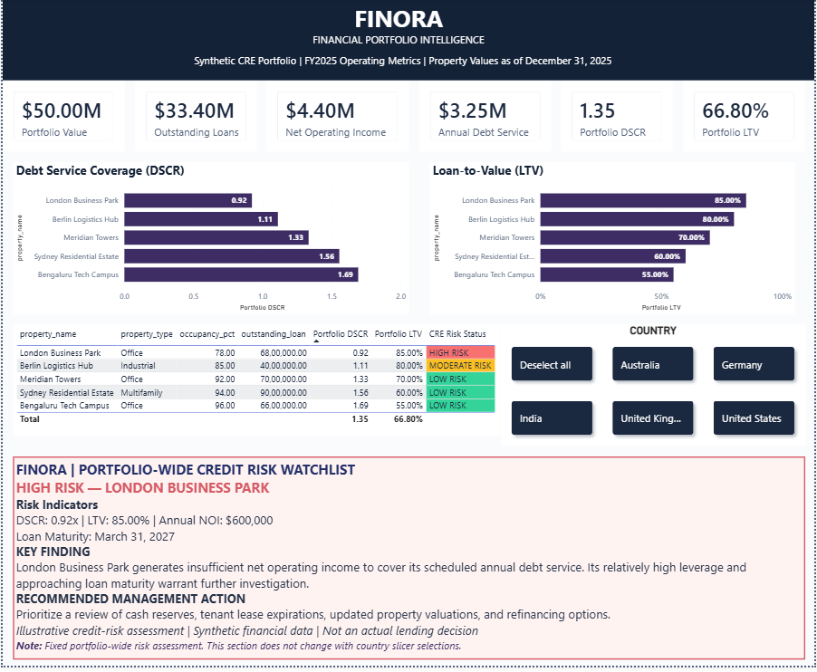
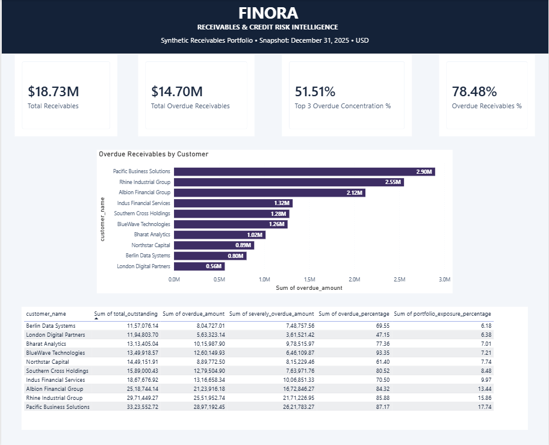
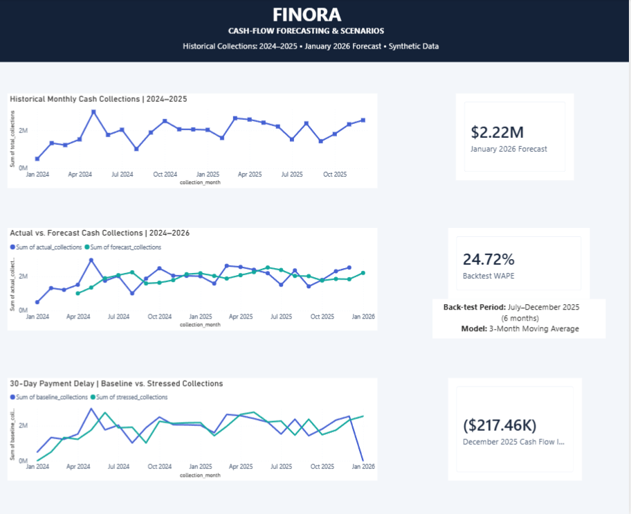
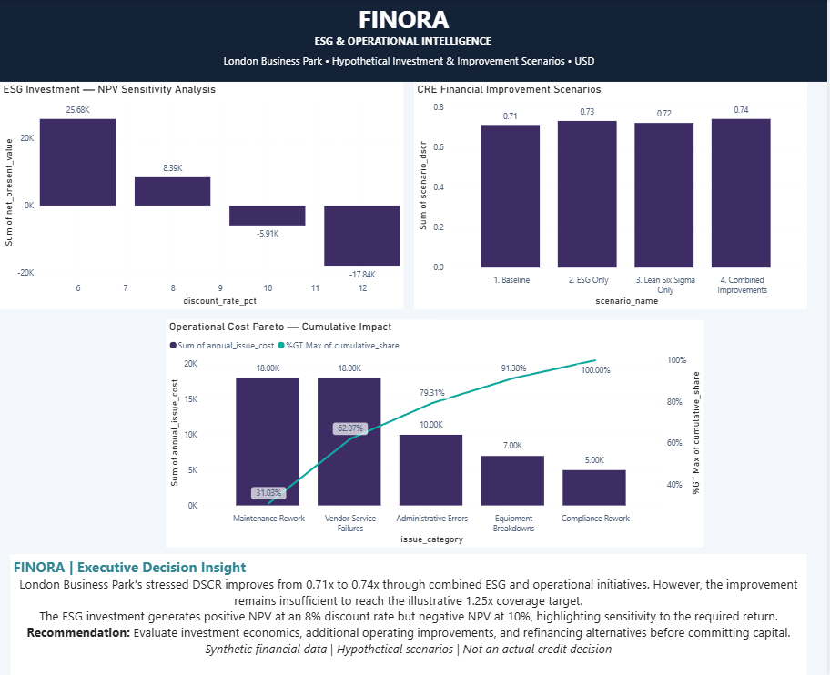

# FINORA | Financial Portfolio Intelligence & Risk Analytics

**Financial decision intelligence across credit risk, commercial real estate, cash-flow forecasting, ESG, and operational performance.**

FINORA is an independent portfolio project demonstrating how financial analysis can be translated into decision-ready executive reporting. It combines a synthetic receivables dataset, a fictional five-property commercial real estate (CRE) portfolio, forecasting backtests, liquidity stress scenarios, investment appraisal, and Lean Six Sigma-style operational analysis.

> **Disclosure:** All companies, customers, properties, transactions, scenarios, and figures shown here are **synthetic or illustrative**. No employer or customer data is used. This is a demonstrative analysis—not a live banking system, financial advice, or a lending recommendation.
>
> **Portfolio version:** This public repository is a *curated showcase*. The full development database, notebooks, and detailed implementation remain in a separate private project. The screenshots and executive report below are available for review.

## Executive dashboards

### 1. CRE Portfolio Intelligence

Five fictional properties across the United States, United Kingdom, India, Germany, and Australia; portfolio financials, DSCR/LTV, property-level risk monitoring, and country filtering.



### 2. Receivables & Credit Risk

Receivables exposure, overdue balances, customer concentration, and risk prioritization at a **December 31, 2025** synthetic reporting snapshot.



### 3. Cash-Flow Forecasting & Scenarios

Historical collections, actual-versus-forecast comparisons, a six-month forecasting backtest, and a simulated **30-day collections delay**.



### 4. ESG & Operational Intelligence

Investment NPV sensitivity, an operational cost Pareto, and the effect of hypothetical ESG and operational savings on stressed CRE debt coverage.



**[View the four-page executive report (PDF)](reports/FINORA_Executive_Report.pdf)**

## Executive highlights

| Analysis area | Selected illustrative finding | Interpretation |
|---|---:|---|
| CRE portfolio | **$50.00M** property value; **$33.40M** debt | Portfolio DSCR **1.35×** and LTV **66.80%** |
| Property risk | **London Business Park: 0.92× DSCR; 85% LTV** | Coverage and leverage warrant closer scrutiny; March 31, 2027 maturity |
| Receivables | **$18.73M** outstanding; **$14.70M** overdue | **78.48%** of outstanding receivables overdue at snapshot |
| Credit concentration | **51.51%** | Share of overdue balances attributable to the three largest overdue customers |
| Forecasting | **24.72% WAPE** | Backtest on **July–December 2025**, using a three-month moving average |
| Forward projection | **$2.22M** | January 2026 synthetic forecast, **not actual collections** |
| Liquidity stress | **−$217,461.83** | December 2025 collections impact under a hypothetical 30-day payment delay |
| ESG investment | **+$8,392 NPV at 8%** | Illustrative investment turns negative at a 10% discount rate |
| Combined improvements | **0.71× → 0.74× stressed DSCR** | Improvement is insufficient to reach the illustrative **1.25×** target |

**Important scope note:** Receivables and forecasting metrics refer to the synthetic reporting periods stated above, not current/live balances. The London credit watchlist in the dashboard is a fixed portfolio-wide narrative and does not respond to country-slicer selections.

## Analytical approach

**Credit risk:** Build exposure snapshots; calculate overdue and severely overdue balances; rank customer exposures; evaluate concentration without summing individual customer percentage ratios.

**CRE portfolio monitoring:** Calculate net operating income (NOI), debt service coverage ratio (DSCR), and loan-to-value ratio (LTV); examine coverage, occupancy, leverage, and upcoming debt maturities.

**Forecasting and liquidity:** Compare simple forecast baselines; backtest a selected three-month moving-average model; assess a calendar-day payment-delay scenario. The simulated delay changes **when** cash is received, not the modeled total receipts over the complete simulation horizon.

**ESG investment appraisal:** Assess an illustrative $120,000 efficiency investment with $15,000 in annual savings; vary the discount rate (6%, 8%, 10%, 12%) to show the sensitivity of investment value to required return. Assumed annual savings, investment life, and implementation economics are scenario inputs, not observed outcomes.

**Operational efficiency:** Apply a cost-ranked Pareto analysis to hypothetical incidents. A modeled $8,100 Lean savings case, combined with ESG energy savings, improves coverage only marginally; additional financing and operational options would still warrant evaluation.

### Selected metric definitions

| Metric | Simplified definition |
|---|---|
| NOI | Effective gross income − property operating expenses |
| DSCR | NOI ÷ annual debt service |
| LTV | Outstanding property loan ÷ property value |
| Overdue receivables share | Total overdue receivables ÷ total outstanding receivables |
| WAPE | Sum of absolute forecast errors ÷ sum of actual collections within the backtest window |
| NPV | Discounted value of modeled future cash benefits − upfront investment |

## Tools and skills demonstrated

**Python & Jupyter · PostgreSQL & SQL · Power BI & DAX · Financial reconciliation · Credit risk · CRE underwriting ratios · Forecasting & backtesting · Scenario analysis · Investment NPV · Pareto analysis**

The underlying full project was developed with the above tools; this **public presentation intentionally includes only visuals, a PDF, and summary methodology**, rather than the complete notebook or database export.

## Repository contents

```text
FINORA-Portfolio/
├── screenshots/
│   ├── 01_CRE_Portfolio.png
│   ├── 02_Receivables_Risk.png
│   ├── 03_Cash_Flow_Forecasting.png
│   └── 04_ESG_Operations.png
├── reports/
│   └── FINORA_Executive_Report.pdf
└── README.md
```

## Interpretation and limitations

- All datasets and results are synthetic or hypothetical; scenario assumptions do not represent observed borrower behavior.
- Portfolio-wide metrics, customer receivables snapshots, forecasting backtests, and hypothetical scenarios have different analytical purposes and reference periods.
- The **24.72%** WAPE reflects a six-month historical backtest, not a guarantee of forward accuracy.
- ESG/Lean scenario benefits should not be mistaken for realized savings; a full investment decision would consider capital costs, execution costs, and uncertainty.
- This curated showcase does not provide the complete implementation or instructions to reproduce every analysis independently. The private development project is separate.

---

*FINORA — turning financial data into risk-aware decisions.*
